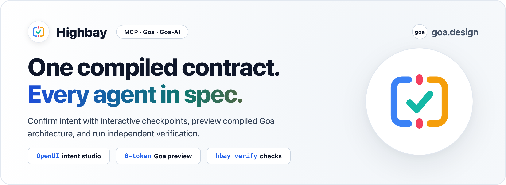

<p align="center">
  <picture>
    <source media="(prefers-color-scheme: dark)" srcset="docs/img/highbay-banner-dark.png">
    
  </picture>
</p>

<p align="center">
  <a href="https://github.com/goadesign/highbay/releases/latest"></a>
  <a href="https://www.npmjs.com/package/@goadesign/highbay"></a>
  <a href="https://glama.ai/mcp/servers/goadesign/highbay"></a>
  <a href="https://serverdex.io/server/io-github-goadesign-highbay/score"></a>
  <a href="https://pkg.go.dev/github.com/goadesign/highbay"></a>
  <a href="https://modelcontextprotocol.io"></a>
  <a href="https://github.com/goadesign/highbay/blob/main/LICENSE"></a>
</p>

# Highbay

**Your agent's tests pass. Did it build what you meant?**

Highbay builds Go services and AI agents with the coding agents you already
use, such as Claude Code, Codex or Cursor. It is free, open source, and runs
on your machine.

A coding agent working alone answers the questions your request left open,
then writes tests that agree with its own answers. The tests pass, and nobody
checked the answers.

Highbay splits that job. You choose the behavior on a page in your browser.
[Goa](https://github.com/goadesign/goa) and
[Goa-AI](https://github.com/goadesign/goa-ai) generate the transports, schemas
and validation from a Go design, so no model writes them. One agent writes the
service code, a different agent writes the scenario tests, and Highbay runs
the accepted tests against the exact commit you then approve and merge.

## One change, start to finish

After [installing Highbay](#install), run `highbay up` once. In an empty project
folder, run `highbay` to open your browser. Choose a coding agent and send it a
goal in **Describe**.

> Build a refund assistant. Refunds up to $50 get instant store credit.
> Larger ones wait for a manager.

If you already have a coding agent open in the project, give it the same
goal with `/highbay` (`$highbay` in Codex). Highbay attaches that session as
the project's guide and opens the browser workspace.

The request leaves one thing unsaid: does $50 count sales tax? One order tells
the two readings apart.

| Order | If $50 means the items, before tax | If $50 means the total charged |
| --- | --- | --- |
| $48.00 items + $4.32 tax = $52.32 | Instant $52.32 credit | Waits for a manager |

An agent working alone picks one reading, then tests a $40 order and a $60
order. Both tests pass under either reading, so they cannot tell you which one
it built. Highbay asks you, then tests the $48 order.

Here is how the change reaches your branch:

1. **Describe.** The guide creates a blank Go project and its first commit
   when the folder is empty. It writes a *Story*, a description of the
   system's flows in Go, and proposes a *Change Card* with your request,
   the questions it leaves open, examples, and the behavior to keep.
2. **Agree.** On the page, answer the questions and confirm. For the refund
   rule, the card shows the $48 order under each answer. If your answer
   differs from the draft, your coding agent revises the card before you
   confirm.
3. **Review the architecture.** The page draws the services, agents and tools
   that the agreed design declares, before any of them is implemented.
4. **Build.** Choose a coding agent and a model for two roles, then press
   **Build this change**. The *builder* writes the service. The *test writer*
   writes one scenario test for each finished flow, in its own working copy.
   Highbay accepts those tests only after it compiles them and confirms that
   nothing outside the test module changed.
5. **Verify.** The builder asks Highbay to verify its commit. Highbay builds
   that commit and runs the accepted tests against it. A failed run goes back
   to the builder, and nothing can be approved until a run passes.
6. **Approve and merge.** Read the report, press **Approve this result**, then
   **Merge into current branch**.

Only you can confirm a change, start a build, approve a result or merge. Each
agent connects to the server with the permissions of its own role. You can go
back at any step: revise the change, build again, or have the tests reported
again. [How Highbay works](docs/HOW_IT_WORKS.md) covers every step, and
[Going back](docs/HOW_IT_WORKS.md#going-back) says what stays valid when you
do.

In one moderated trial, an AI agent played a first-time developer on a sample
property-listing app. The test writer's scenario for withdrawing a listing had
32 named checks, and the builder's first commit failed two of them. Highbay
reported seven of eight scenarios passing, the builder fixed it, and the same
tests passed eight of eight about three minutes later. That was a trial with a
scripted model, not a production incident.

## The agreement is code

What you agree to becomes three small pieces of Go that use the same order and
the same numbers. These excerpts illustrate the refund example; they are not
files in this repository.

```go
// design/story.go
// 1. The flow you confirmed, drafted by your coding agent.
package design

import . "github.com/goadesign/highbay/story/dsl"

var _ = Story("Refunds", func() {
	Actor("customer", "Customer")
	// A flow with a start, an outcome and no open question is finished.
	// Every finished flow needs a scenario test before a build counts.
	Flow("instant_credit", "Up to $50 subtotal", func() {
		StartsWith("ask", "customer", "$48.00 + $4.32 tax")
		Outcome("credit", "customer", "Instant $52.32 credit")
	})
})
```

```go
// eval/acceptance/refunds.go
// 2. The scenario, written by the test writer from your answer.
func (h *Hooks) InstantCredit(ctx context.Context) (eval.Result, error) {
	// $48.00 + $4.32 tax = $52.32: the order that tells the readings apart.
	out, err := h.refund(ctx, 4800, 432)
	if err != nil {
		return eval.Result{}, err
	}
	return eval.Result{Checks: []eval.Check{
		check("status", out.Status == "credit"),
		check("cents", out.Cents == 5232),
	}}, nil
}
```

```go
// internal/refunds/service.go
// 3. The rule, written by the builder against the payload and result types
//    that Goa generated from the design.
func (s *Service) RequestRefund(
	ctx context.Context, req *genrefunds.RequestPayload,
) (*genrefunds.RefundResult, error) {
	total := req.SubtotalCents + req.TaxCents
	if req.SubtotalCents <= 5000 { // the limit counts the items, as you chose
		return s.issueCredit(ctx, req.OrderID, total)
	}
	return s.queueReview(ctx, req.OrderID, total)
}
```

If the builder had compared `total` instead, the scenario would fail on the
$48 order and the run could not be approved.

## Generated plumbing, written by no model

Agents write a compact Go design and the business logic. Goa and Goa-AI
generate the rest from the design. This method comes from the
[Orders example](examples/orders/README.md) in this repository:

```go
// examples/orders/design/orders.go: what an agent writes.
Method("chat", func() {
	Description("Send a message to the refund assistant and start a run.")
	Payload(func() {
		Token("token", String, "Customer bearer token.")
		// MinLength becomes a check in the generated HTTP request decoder.
		Attribute("message", String, "What the customer says.", func() { MinLength(1) })
		Required("token", "message")
	})
	Result(RunView)
	HTTP(func() {
		POST("/chat")
		Response(StatusAccepted)
	})
})
```

```go
// examples/orders/gen/orders/service.go: what Goa generates for it.
type Service interface {
	// Send a message to the refund assistant and start a run.
	Chat(context.Context, *ChatPayload) (res *RunView, err error)
	// ...
}
```

From that one method Goa also generates the HTTP route, the request decoder
that checks the message length, a typed client and the OpenAPI description.
For a coding agent this has three effects:

- **No model writes the generated files.** The generator does. Agents still
  spend tokens on the design and the logic, so the overall saving depends on
  the change. Highbay does not claim a measured figure.
- **The same shape from any model.** Generated code looks the same whether
  Claude, Codex or Gemini wrote the logic around it.
- **A changed interface breaks stale code.** If the design gives a method a
  new result type, a handler that returns the old type no longer implements
  the generated interface, and the build fails until you update it.

Highbay generates the transports a design declares: HTTP, JSON-RPC and MCP. It
refuses a design with gRPC transports; see
[`highbay gen`](docs/REFERENCE.md#highbay-gen).

## Words you will meet

| Term | Meaning |
| --- | --- |
| **The server** | The project's Highbay server, one per project folder. It keeps what you agreed, who was asked to do what and what was accepted, and it runs the checks. |
| **The page** | The server's page in your browser. You agree on changes and approve results there. |
| **Story** | A description of what the system does, written as Go in the project's design, one flow at a time. |
| **Flow** | One path through a Story: who starts it, the steps, and the outcome. A flow with a start, an outcome and no open question is *finished*. |
| **Change Card** | One proposed change: the request, the Story, open questions, concrete examples and the behavior to keep. |
| **The guide** | The role of the coding agent you talk to. It writes the Story and proposes changes. |
| **The builder** | The agent that writes the application code. |
| **The test writer** | The agent that writes the change's scenario tests, in its own working copy. |
| **Herdr Core** | The local runtime that starts interactive agent terminals. Open a role's terminal in Highbay. |
| **Chorus** | The local messaging service that carries the project conversation between the browser and agents. |

## What Highbay does not do

- **It is not a sandbox.** All agents run as you on one machine. Highbay runs
  the code they write as ordinary programs with your access to files and the
  network. Roles limit what each agent can do in Highbay, not what its
  programs can reach. The page says so next to **Build this change**. One
  check, the builder's compile and unit test run, uses a local Docker
  container; see [`check_project`](docs/REFERENCE.md#check_project).
- **It does not judge what a test asserts.** Highbay checks that every
  finished flow has a scenario test and that the tests build, then runs them.
  Whether the assertions are strong enough remains your review. The page
  shows which answers and examples the test writer says each scenario covers.
- **It builds Goa projects only.** Highbay works on Go services and agents
  designed with Goa and Goa-AI. Other languages and frameworks are out of
  scope.

## Install

Highbay needs:

- **macOS or Linux.**
- **Go 1.27.3** or newer.
- **Git 2.45** or newer, with your name and address configured. Highbay
  records accepted tests as commits under your identity.
- **Docker Desktop**, or another local Docker engine, for the builder's
  checks.
- **A coding agent that supports MCP.** The
  [setup reference](docs/REFERENCE.md#highbay-setup--global) lists the clients
  that setup registers.

Choose an installation method.

```bash
# Homebrew.
brew install goadesign/tap/highbay
highbay up

# npm, with Node.js 20 or later.
npx @goadesign/highbay up

# Shell installer. It verifies the release and runs highbay up.
curl -fsSL https://raw.githubusercontent.com/goadesign/highbay/main/scripts/install.sh | sh
```

Run `highbay` from your project folder. If you installed through npm, use
`npx @goadesign/highbay`.

`highbay up` checks Go, Git, and Docker, offers to install compatible Herdr Core
and Chorus executables when needed, and registers Highbay with the coding
agents it detects. Herdr Core runs the agents' terminals. Chorus carries
the messages you see in **Conversation**. Reload an already open coding
agent to discover the `/highbay` skill, and rerun `highbay up` after installing
another agent. See [prerequisites and install options](docs/REFERENCE.md#prerequisites).

You can also install from a published Go release with
`go install github.com/goadesign/highbay/cmd/highbay@latest`, then run `highbay up`.
For a development build, see [`highbay init`](docs/REFERENCE.md#highbay-init) to
select the published Highbay module a new project will use.

**Highbay needs no account and no model key.** Each coding agent uses its own
sign-in. The tests a test writer wrote receive no provider key; a test of an
agent uses a scripted model kept in the test module. A provider key or a
model gateway matters in two cases. The first is when the
builder tries prompt wording on a *live target*, a running copy of the
application that the server starts from a commit. The second is when you
register a test program of your own that calls a live model. For a live
target, export the provider's key, such as `ANTHROPIC_API_KEY` or
`OPENAI_API_KEY`, in the environment that starts your coding agent. Your
coding agent must pass that environment on to Highbay; see
[stdio integration](docs/REFERENCE.md#highbay-stdio). While no model is chosen,
live targets then use `claude-sonnet-4-6` or `gpt-5.4-mini`, and the page's
**Live target** view changes the model.

## Update Highbay

Run `highbay update` or choose **Update & Restart** when the browser offers a
new release. Highbay installs the version you approve and restarts the
project server in place. The browser session and running agent terminals
can continue. Choose **Reload** when you are ready to load the updated
workspace.

Run `highbay update -check` to see the available release without installing
it. For npm installations, use `npx @goadesign/highbay@latest` or update
the global package with `npm install -g @goadesign/highbay@latest`. See the
[update command](docs/REFERENCE.md#highbay-update).

## Start a project

**In an empty folder,** run `highbay`, choose a coding agent, and describe your
goal in **Describe**. The guide creates a blank Goa and Goa-AI starter with an
architecture diagram, an empty Story, and a test module with one startup test.
See [`init_project`](docs/REFERENCE.md#init_project).

**In a project you already have,** Highbay needs a Goa or Goa-AI project with
at least one Git commit and tests it can run. Those tests are either a test
module in Highbay's layout or a test program of your own that you register
with `highbay verification set`. With your own program, Highbay uses it for
every change and starts no test writer. See
[what a build adds](docs/HOW_IT_WORKS.md#what-a-build-adds).

The browser stays signed in during a reload while the project server is
running. Run `highbay` to reopen the page, or ask your connected coding agent
to open it. Use **Conversation** to send messages and open a role's
**Terminal** when it needs an answer or permission.
[Terminal operation](docs/REFERENCE.md#terminal-and-browser-automation)
covers `highbay --print-link`, `highbay status` and `highbay stop` for operators and
browser automation.

## Use the tools without a team

These commands need no server, no agents and no model key. They run Goa with
the module's own versions, so no separately installed `goa` is needed.

```bash
# Create a blank service and its test module.
# Add -example for a worked example, a price-answering service.
highbay init -dir shop -module example.com/shop

# Compile shop/design and print its containers, boundary edges,
# agent policies and tool contracts.
highbay preview -dir shop

# Regenerate shop/gen after you edit shop/design.
highbay gen -dir shop

# List all commands. "highbay help <command>" prints a command's flags.
highbay help
```

The [Orders example](examples/orders/README.md) is a complete platform with
its own test suite. From a checkout, `highbay preview -dir examples/orders`
prints its architecture. The [reference](docs/REFERENCE.md#highbay-verify) covers
`highbay verify` and `highbay approve`, which check a commit against a test suite
outside any server.

## Dive deeper

- **[How Highbay works](docs/HOW_IT_WORKS.md)**: the journey step by step, by
  who acts.
- **[Reference](docs/REFERENCE.md)**: commands, MCP tools, builds, the page and
  the server's contracts.
- **[Story language](story/README.md)**: the declarations a Story is written
  with.
- **[Golden Path architecture](docs/ARCHITECTURE_PLAYBOOK.md)**: the built-in
  rules every agent follows, and who owns what in Highbay.
- **[Story flows and the tests a build requires](docs/STORY_TEST_DESIGN.md)**:
  for contributors, how a Story becomes tests and how Highbay checks them.
- **[Orders example](examples/orders/README.md)**: a complete platform with
  its test suite.
- **[Product direction](docs/PRODUCT_DIRECTION.md)**: what Highbay is meant to
  be and for whom.

> **Why the name?** A high bay is a tall factory hall where large things are
> assembled and inspected before they leave. Highbay does the same for a
> change: it is built, checked against what you agreed, and only then merged.

## License

Highbay is released under the [MIT License](LICENSE).
