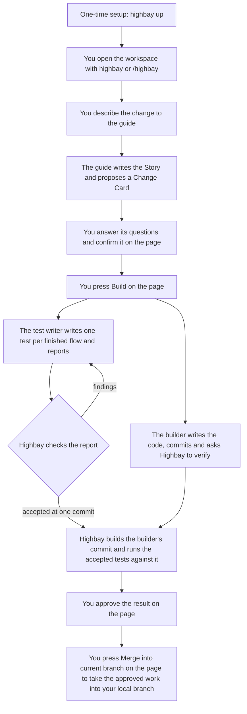

# How Highbay Works

**[← Back to README](../README.md)** · **[Golden Path Architecture →](ARCHITECTURE_PLAYBOOK.md)** · **[CLI & MCP Reference →](REFERENCE.md)**

This page follows one change through Highbay from the first conversation to the
merge. For each step it says what you do and see, what each agent does, and
what the server records. The [reference](REFERENCE.md) holds the exact
contract of every command, tool and field.

## Who does what

A change involves you, three coding agents and one server per project folder.
Each has its own credential, so the server always knows who is calling.

| Who or what | What it is | Trusted for |
| --- | --- | --- |
| You, the user | The person who describes the goal to a coding agent and acts on the page in a browser. | The only one who confirms a change, starts a build, approves a result and can request a merge. |
| The guide | The coding agent you talk to about what should change (registered internally under the `guide` role). | Writing the Story (described below) and proposing the change. Highbay checks the proposal's shape, not whether it is right: you judge that when you confirm it. |
| The builder | The coding agent that writes the application's code, in its own working copy of the project (`.highbay-build`). | Nothing on its word: its work counts only when Highbay verifies a commit of it. |
| The test writer | The coding agent that writes the tests for a build, in its own working copy of the project. | Nothing on its word: its tests count only when Highbay's check accepts them. |
| The server | The project's Highbay server. The guide's first Highbay call starts or attaches to one for each project folder. It keeps the record of what was agreed, built, accepted and approved, and it runs every check. | Deciding, from the files the agents produce, whether work is done. |
| The page | A page in your browser that the server serves; the reference calls it the views page. It talks to the server as you. | Carrying your decisions. No agent has your identity. |
| Herdr Core | The local process that runs the agents in interactive terminals. | Keeping the terminals alive while you move between views. |
| Chorus | The local service that carries messages between you and the project's agents. | Carrying conversation. Work counts when Highbay verifies it. |

Highbay runs the code the agents write (the design at each refresh, the
builder's programs and the test writer's tests) as ordinary processes on this
machine, with your file and network access. Through the project server, Story
refreshes, starter initialization, test-report checks, live starts and verifications
share the project's compiled Go packages. Each operation still builds its outputs and
runs its checks; a cache hit is never a passed check. Code running as you can
change retained compiler inputs
and affect later results. See [project storage and cache trust](REFERENCE.md#project-state-folder)
for lifetime and cleanup.

Three more words appear on every step:

- A **Story** is a plain description of what the system does, written as Go
  code in the project's design. It names the actors and their **flows**. A flow
  is one path from a starting event to an outcome, for example "an alert fires
  for an unhealthy production deploy and the remediation agent pauses for
  on-call approval before rolling back". A flow with a start, at least one
  outcome and no open question is **finished**; any other flow is a draft. See
  the [Story language](../story/README.md).
- A **Change Card** is the server's record of one change: your request, the
  guide's analysis of it, the questions only you can answer, your answers and
  the Story it was made from.
- A **`request_revision`** is the digest of one exact version of a Change
  Card. Building, verifying and approving each name it, so none of them can
  apply to a version you did not confirm.

The table below also names the **live target**: a running copy of your
application that the server builds from a commit, so the builder can try
prompt wording before committing it (see
[Trying prompt wording on a live target](#trying-prompt-wording-on-a-live-target)).

The server decides who may call what from one table. A call by anyone else is
refused with `forbidden` before anything changes. The agents call the server
through an MCP (Model Context Protocol) connection named `highbay`. You and the
agents can read the Golden Path, Highbay's built-in architecture playbook,
published as the resource `highbay://golden-path`.

| Caller | Connects through | What it may do |
| --- | --- | --- |
| You | The views page or the user API | Confirm a change, adopt or decline a proposed revision, start or drop a build, approve a result, request a merge, choose the model live targets use, stop a live target, start agents, send them messages, and interact with their terminals. You read everything the page shows. |
| The guide | Its `highbay` MCP connection | Create a starter project, have the Story evaluated, propose and revise changes, and open the page for you. It reads the changes, builds and verification runs. |
| The builder | Its `highbay` MCP connection | Read its assignments, generate code, check the project, update its dependencies, run a live target and send prompt drafts to it, and ask the server to verify a commit. It reads the changes, builds and verification runs. |
| The test writer | Its `highbay` MCP connection | Read its test assignments and report its tests finished. It reads the build, and the verification runs of the changes it has an assignment for. |
| Local project integrations, including the `highbay` command | The server's management credential | Read project status, attach a guide, open the page and stop the server. It makes no decision about the application. |

The reference lists [every operation and who may call it](REFERENCE.md#mcp-tools--resources)
and describes [each operation](REFERENCE.md#mcp-tools).

The roles separate duties; they do not wall the agents off from each other.
All of them run as you, on one machine, and every result that depends on that
says so.

## The journey at a glance



Tool descriptions and the server's terminal name these steps by checkpoint:

| Checkpoint | Step on this page |
| --- | --- |
| `CP1` | [Agreeing on a change](#agreeing-on-a-change) |
| `CP2` | [Previewing the architecture](#previewing-the-architecture) |
| `CP3` | [Trying prompt wording on a live target](#trying-prompt-wording-on-a-live-target) |
| `CP4` | [Verifying the builder's commit](#verifying-the-builders-commit) |
| `CP5` | [Approving and merging](#approving-and-merging) |

Approval records the verified work you accepted. Merging is a separate
decision, with a local branch as its destination.

## Starting: `highbay`, the team and the page

After [installing Highbay](../README.md#install), run [`highbay up`](REFERENCE.md#highbay-up)
once. It checks dependencies, registers Highbay with detected coding agents,
and starts its companion services. Run `highbay` in your project folder to open
the browser workspace. On **Describe**, choose an installed coding agent and
send your request. Highbay starts that agent as the project's guide and posts
your message to **Conversation**. In an empty folder, the guide creates a
blank Go project and first commit before it drafts a change.

If you already have a coding session in the project, invoke `/highbay`
(`$highbay` in Codex) with your request. Its first Highbay tool call starts
or connects to the project server and registers that session as the guide.
The guide opens the workspace and uses Chorus for project messages. When
Highbay can match the session to a live Herdr Core terminal, you can also
open its **Terminal** in the browser. An external IDE session keeps its
terminal in the IDE.

After a reload, the browser uses its existing session while the project
server is running. To reopen the workspace, run `highbay` again or ask the guide
to open it. On the first change, the welcome view shows the progress of
[`init_project`](REFERENCE.md#init_project) and the first proposal.

When a release is available, **Update & Restart** installs the version
shown and waits for the project server to return. The browser keeps your
current workspace and offers **Reload** when the new page is ready. You
can also check from the terminal with [`highbay update -check`](REFERENCE.md#highbay-update).

For terminal operation and browser automation, `highbay --print-link` prints
the one-use URL and expiry as JSON, and `highbay status --json` reads the
server's current stage and role states. If you open a fresh link in a tab
with unsaved input, save or discard your edits and then choose **Open link**.
The two-minute expiry starts when the link is issued. See
[startup and recovery](REFERENCE.md#highbay-and-highbay-stop).

The Studio header offers **Describe** (or **Changes**), **+ New change**, and
the five-step change journey **Agree → Architecture → Build → Verify →
Approve**, while **Inspect** opens Story, Team, Live target and Diagnostics.
On desktop viewports, the active stage occupies a single main column (with any
open agent terminal docked beneath that stage column) beside the sticky
**Conversation** dock; on narrow viewports, Stage, Conversation, and Terminal
switch cleanly one surface at a time. Agreed, Status, and Next keep the current
context and decision visible; on a phone, Next moves to the bottom of the
viewport. The frame previews at most two lines of the agreed summary. **Read
full summary** opens Agree at the complete saved summary, keeping unsaved edits
per Change Card. On Describe, with no change open for editing, it shows no
agreement.

| View | What it is for |
| --- | --- |
| Describe / Changes | Start your first project goal or browse saved Change Cards (most recently saved first, each with its latest saved verification run). **+ New change** drafts a separate Change Card at any time. |
| Conversation | The project's messages and pinned instructions. Send a message to the team, ask Guide to revise the open Change Card, or mention a role directly. |
| Team | Each role's status, assignment, and saved coding-agent choices. **Start workers** starts missing workers with work on the build. Watch a running role's **Terminal** passively, or choose **Type in terminal** to answer prompts interactively. |
| Story | The Story of the change shown, and the guide's latest Story draft. |
| Live target | The running copy of your application that the builder tries prompts on, and the model connection it uses. |
| Agree | The Change Card: its questions, your answers, confirmation, refinements, and any proposed revision. Unsaved edits stay isolated per Change Card when you move to another stage or card. |
| Build | The saved build and its next step, with a folded read-only agreement summary and saved approval link below. |
| Architecture | The optional C4 architecture preview of the confirmed card. |
| Verify | The change’s saved verification runs and their test details. |
| Approve | The selected run’s recorded Story, finished flows and required test outcomes, excluded drafts, unknown coverage, approval requirements and verified commits. Next offers **Approve this result** when available, then **Merge into current branch** for the current approved result. |

A **Diagnostics** drawer shows the server's [operation diagnostics](REFERENCE.md#operation-diagnostics).
The [views page reference](REFERENCE.md#views-page) describes each view in
full. `highbay stop` stops the server in order; see
[the `highbay` command](REFERENCE.md#highbay-and-highbay-stop).

## Agreeing on a change

You send your request to the guide in **Conversation**, for example "Build a
multi-tenant incident platform: a triage agent and remediation agent with MCP
tools to search pod logs, correlate deploys, and roll back services with
on-call approval."

1. **The guide writes the Story.** It calls `refresh_story`, which makes the
   guide's `.highbay-draft` copy in the project folder when needed, returns that
   `draft_folder` at once, and evaluates its design (`go.mod`, `go.sum` and
   `design/`). The guide edits the Story and design only in `.highbay-draft`
   (never in the project folder) and calls `refresh_story` again to evaluate
   its edits. Before drafting a new change, or when a design file changed in the
   project folder outside Highbay, the guide calls `update_draft` to bring the
   project folder's design changes into `.highbay-draft`. Each `to_correct` entry
   names the folder holding the file: the guide corrects its draft, or tells
   you what to correct in the project folder and waits. It calls `update_draft`
   again until none remains, then `refresh_story`. `get_story_refresh` returns the Story the
   server found: actors, finished and draft flows, steps and open questions. The
   Story view shows that draft while the guide works. Where the Story starts
   from depends on the project:
   - A new project's Story file, `design/story.go`, declares no Story yet.
     The guide writes your Story and its flows there, in `.highbay-draft`. A
     project created as Highbay's worked example already has a Story with one
     finished flow, `prices-cookie`, and the test that flow requires.
   - In a folder with no service, the guide first creates the starter
     project with [`init_project`](REFERENCE.md#init_project). It can pass
     `dir: "."` (and omit `module_path`, so Highbay derives one from the folder
     name) to put the service, Story, test module in `eval/` and first
     commit into the existing folder while preserving supported agent
     configuration. Omitting `dir` when `module_path` is given creates a child
     folder named for the service and makes it the server's active workspace;
     omitting both initializes `.` in place.
   - In a project made another way, the design can import the Story language
     only when the draft's `go.mod` requires its module. When it does not,
     the failed evaluation names the step: “`In the folder that holds that
     go.mod, run: go get github.com/goadesign/highbay/story@<version>, then try
     again.`” The version is the one Highbay's own `go.mod` requires. The guide
     runs the command in its draft, whose `go.mod` was evaluated.
2. **The guide proposes the change.** It calls `propose_change` with your
   request, its analysis and the Story refresh it made, which a project with a
   `go.mod` requires. Highbay runs no model for this step. It checks the analysis's shape,
   assigns the IDs of its questions and examples, and saves it as a Change
   Card in the project's private state folder, where it waits for you. The
   card appears in the Describe view by itself.
3. **You answer and confirm.** In Agree you read the card,
   answer each question and press **Confirm Intent & Lock Examples**. When an
   open question changes the draft design, Story, examples or preserved
   behaviors, the guide sets `draft_option` to the choice the current draft
   implements (**Matches current draft**). Selecting another option keeps your
   choice in view, withholds confirmation so you never lock a self-contradictory
   agreement, and offers a one-click request for your coding agent to revise the
   card first. Once every selected answer fits the draft, confirming marks the
   card `confirmed`, records you as the one who confirmed it, and computes its
   `request_revision`. That revision is the **agreed revision**.

A card for the incident-platform request holds, for example:

```text
Change ops-copilot-platform · needs confirmation

Examples
  check_01  Prompt-injected log line attempts org_id spoof → bound to caller's verified org_id   deterministic
  check_02  Unhealthy production deploy triggers rollback → pauses at Confirmation for on-call  deterministic
  check_03  On-call declines rollback with a note          → incident summary explains why       model_judged

Questions only you can answer
  ops-copilot-ambiguity-01  Where should RemediationAgent draw the autonomy boundary for rollbacks?
                            (Autonomous staging rollbacks with production Confirmation, or Confirmation everywhere?)
```

`deterministic` means code can check the outcome directly; `model_judged`
means checking it needs judgment. This is a label saved with the example, for
you and the test writer, not an automatic per-example model judge.
Verification runs the test module's scenarios, not the card's examples
directly, and needs no model API key: a test of an agent plans with a
scripted model kept in the test module. A
stored custom [verification evaluator](REFERENCE.md#highbay-verification-and-highbay-promotion)
can use configured model provider credentials: the label
does not select how or whether a scenario runs, and configuring a **Live
target** model lets the builder try prompt wording live rather than
automatically judging `model_judged` examples. Check scenario coverage in
**Build** to see which examples the test writer's scenarios cover. Highbay cannot
tell whether the analysis is
complete or correct. You decide that when you confirm the card.

The guide can revise the change at any time with `revise_change`. A revision
restates the whole request as it now stands, so **Requested change** holds
every requirement that still applies, with additions, changes and removals
applied, and its **Revision note** says what this revision changed and why.
Before you confirm, the revision replaces the card's content and waits for
your answers.
After you confirm, it waits beside the agreed revision as a **proposed
revision**; see [Going back](#going-back).

## Previewing the architecture

The Architecture view asks the server for
`preview_architecture` on the confirmed card. The server returns the
architecture that the guide's Story refresh evaluated for the agreed revision
and that was saved with it; it reads and evaluates no file, so a later edit of
the draft or of the project does not change it. It shows what the design
declares: its
containers and the calls between them, each agent's time and tool-call
limits, and each tool's schemas, including whether a tool declares a
design-time `Confirmation` gate.

The preview does not compare the design with the Change Card. A declared
`Confirmation` gate means the runtime pauses a run for approval before it
calls the tool's method; it does not show that the service delivers the
request to the right person and continues after the answer. The
[`examples/orders`](../examples/orders/README.md) platform implements that
workflow for a manager approving refunds. To read a design without a Change
Card, run `highbay preview -dir <module>`.

## Building

After confirming, choose the required agents, models and permissions inline
in Build, then press **Build this change**. Choices start from saved project
preferences or installed defaults, preferring different agent families for
the builder and test writer. One installed family can fill both roles. A
project with configured tests needs only a builder. Only the roles needed
for this start need choices; a running guide keeps its session.

Coding agents start in interactive terminals. Build explains the selected
client's permission mode before starting. If a client needs your approval,
open its **Terminal** to respond. A missing client produces an installation
step in the picker. You can dismiss the recommendation to use different
agent families when the project needs both workers.

The saved agreement stays below the build under **Agreed:** and your request. Open **Agreement details** to review it or **Refine agreed
answers and examples** to edit it. The build control explains which agents
start and that, from Build on, the tests and the builder's code run on this
machine as ordinary programs, with your access to files and the network;
nothing confines them, and approval decides only what merges. **Stored
verification settings**
name a test suite of your own, an **evaluator**, at
one exact commit; you save them with `highbay verification set <file>`, and
they apply when the server starts again. Building always uses the agreed
revision, including while a proposed revision waits.
The reference gives the exact contract of
[builds and assignments](REFERENCE.md#builds-and-assignments).

### What a build adds

1. **The server checks first.** It refuses the start, and saves nothing, when
   another change's open build is not yet merged or dropped
   (`previous_change_open`), when rebuilding an unfinished open build without
   confirming replacement (`unfinished_build_open`), when the revision was
   drafted before a drop (`drafted_before_drop`) or a design file at the
   build's base commit was changed outside Highbay (`design_changed_outside`), when
   the card is not confirmed or the revision is not the agreed one, or when
   the project lacks a Git repository with at least one commit, a Git name and
   address, the test module `highbay init` makes (`eval/` in the project folder,
   unless verification settings are stored), `.highbay-build` and `.highbay-tests`
   folders and `highbay/build-<n>` and `highbay/tests-<n>` branches that nothing
   else uses, or when another build start, an assignment read, one of the
   builder's tool calls or a test check is in progress. Each refusal says what
   is missing and the step to take; the reference lists them under
   [`start_build`](REFERENCE.md#start_build).
2. **The server saves the open build and creates any missing working copies**
   (`.highbay-build` on `highbay/build-<n>`, and `.highbay-tests` on `highbay/tests-<n>`
   when written tests are used) at the build's base commit, leaving existing
   copies where they are. The saved build records the build's number `n` and
   base commit, the agreed revision, its Story and its design, and the answers,
   examples and preserved behaviors you confirmed for it.
3. **It registers the builder and the test writer**, each with its own
   credential and working copy. The builder works in `.highbay-build`; the test
   writer works in `.highbay-tests`.
4. **Each worker's first assignment read joins its copy and prepares the
   required tests.** When the builder or the test writer first reads its
   assignment for a new build, Highbay joins its working copy to `highbay/build-<n>`
   or `highbay/tests-<n>` at the build's base commit. For each finished flow of
   the Story, `get_test_writer_assignment` generates one required test into the
   working copy's test module when marking an assigned build's assignment read.
   Draft flows require none. The Build section shows the count, for example
   "3 required Story tests."
5. **It starts missing workers.** The server uses each worker's saved choice
   when it is available or selects an installed default. You can see status
   in **Team**, send questions in **Conversation**, and open a worker's
   **Terminal** when it needs you.

The work belongs to the server and continues if you close the page. Saving
the build and making missing working copies have a five-minute limit. The
test writer has a separate five-minute limit for preparing the required
tests on the first assignment read. A team startup failure leaves the build
saved. Resolve the reported cause, then choose **Start workers** in Team.

With stored verification settings, the project verifies with the evaluator
those settings name. Building then adds only the builder in its `.highbay-build`
working copy (it uses no `.highbay-tests` working copy), and the Build section
shows `Test writer: not needed; this project uses its configured tests`. See
[`highbay verification`](REFERENCE.md#highbay-verification-and-highbay-promotion).

### What appears in the project folder

| What | Where | Why |
| --- | --- | --- |
| The builder's working copy | `.highbay-build/` inside the project folder | A linked Git working copy (`git worktree`) of the repository, where the builder writes and commits the application's code. |
| The builder's branch | `highbay/build-<n>` | The numbered branch for build `n` checked out in `.highbay-build`, starting at the build's base commit. |
| The test writer's working copy | `.highbay-tests/` inside the project folder | A linked Git working copy (`git worktree`) of the repository, where the test writer writes its tests. |
| The tests branch | `highbay/tests-<n>` | The numbered branch for build `n` checked out in `.highbay-tests`, starting at the build's base commit, where Highbay commits the accepted tests. |
| Three lines in the repository's local exclude file | `# Highbay's working copies.`, `.highbay-build/` and `.highbay-tests/` in `.git/info/exclude` | Keeps the working copies out of `git status`. No tracked file of the project changes. |

Starting a build creates any missing working copy at the build's base commit
and leaves existing copies where they are. When the builder or the test writer
first reads its assignment for a new numbered build, Highbay switches its copy
to `highbay/build-<n>` or `highbay/tests-<n>` at the build's base commit: if the
copy is on an earlier build branch of that role (`highbay/build-<k>` or
`highbay/tests-<k>`), Highbay first commits any uncommitted files left there onto
that earlier branch with the message `Left uncommitted when change <id>
started`; if uncommitted work sits on another branch or a Git operation is in
progress, the read is refused with `copy_off_branch`.

### The test writer writes the tests

The test writer reads its assignment with `get_test_writer_assignment`: the
working folder, the design and Story as agreed at the built revision, your
answers, examples and preserved behaviors as you confirmed them, and one
required test per finished flow. It may not read the change itself, so the
assignment is how its tests learn what you agreed, and they must hold the
service to it as well as to the Story's flows. It writes the tests inside the
test module, `eval/` in its working copy, and changes nothing outside it.
Highbay declares the required tests in that module's Story table,
`eval/design/story_tests.go`, which it writes when `get_test_writer_assignment`
marks an assigned build's assignment read and again at each report; the test
writer leaves that file as it is, and regenerating the
module keeps the required tests. After changing the module's design, the
test writer reports to have it generated again or runs
`highbay gen -dir eval` in its working copy first. It checks
its work with `GOWORK=off go build ./...` in `eval/`, which fails naming any required
method not yet written, and does not compile or start the candidate service
binary itself—Highbay's verification builds and runs the candidate.
Then it calls `report_tests_finished`, including which agreed answers and
examples each scenario is stated to cover and an explanation; an empty
statement list means **Not stated**. The report returns at once with the
report's number; the build shows the test writer as **Reported**. The
project's first test, the method `StartsAndListens` in `eval/acceptance`,
shows the form to follow; Highbay's worked example also has `PricesCookie`, the
test of its own flow.

After acceptance, Build shows **Test writer's stated coverage** against your
agreed answers and examples. Highbay validates the references and checks that the
tests build and declare their required scenarios; it does not judge the
writer's coverage statements. Approve shows the same recorded statements
beside the selected run's results, even after later changes. An answer or
example without a statement says **Not stated**, which does not establish
whether it was tested.

### Highbay checks the tests

Highbay, not the test writer, decides whether the tests count. Right after each
report, the server checks the working copy without trusting its author (the
reference gives the check's limits under
[judging reports](REFERENCE.md#judging-reports)):

1. It checks that `.highbay-tests` is on `highbay/tests-<n>` with no Git operation
   in progress, and compares the copy's files with the build's base commit, so
   the test writer's own commits on `highbay/tests-<n>` count too. Any changed
   file outside the test module is a finding.
2. It writes the required tests again from the Story saved with the build, so
   the test writer cannot change what is required.
3. It builds the generated test program, `gen/cmd/<name>-evals` in the test
   module. A compiler error, such as a missing
   method, is a finding.
4. It runs the program's `--describe` to list the scenarios,
   the named tests, it declares. A required scenario that is missing is a
   finding, and so is a scenario tagged `holdout`, the tag that hides a
   scenario from what the server returns (see
   [hidden scenarios](#verifying-the-builders-commit)). Before recording an
   acceptance, Highbay also checks that the tip of `highbay/tests-<n>` descends
   from the build's base commit without commits from other builds' branches.

The build and the listing run as ordinary processes with your file and network
access, each in its own process group that the check stops. A process that
starts its own session leaves its group and keeps running.

The verdict replaces **Reported** and marks the test writer's assignment
unread, so it reads it again.

| Verdict on the page | What happened | Who acts |
| --- | --- | --- |
| Needs changes | Highbay found problems, including when building the test program hits the 10-minute limit (`The test program did not finish building within 10 minutes. Report again: the retained build cache can reuse compilation that completed. If it still does not finish, make the test module build faster, for example with fewer or smaller dependencies.`) or listing hits the 60-second limit. Build shows the saved required tests beside Highbay’s findings, including the exact scenario and hook for each finished flow. Next says that the test writer corrects and reports again; the verdict alone asks for no user decision. A failed findings read retains the count and offers **Retry findings read**. | The test writer reads them in its assignment, fixes them and reports again. |
| Accepted | Highbay committed exactly the checked files on `highbay/tests-<n>`, with your Git identity and the message `Add the tests Highbay accepted for change <id>, report <n>`. The build details show that commit. The builder's assignment is marked unread too. | The builder can verify or start a live target with the chosen model. |
| Could not run | The check stopped for a cause the test writer cannot fix, such as the 15-minute whole-check time limit, Git trouble, or dependencies that cannot be downloaded where Highbay runs. The page shows the reason and your step. | You take the step; it says whether the test writer then reports again or you build again. |

An acceptance always carries the same sentence, which the page shows: "Highbay
checked that these tests build into the generated test program and declare
every required scenario; it did not judge what they assert." Whether the
tests check the right things is still yours to judge.

When findings are sent back, the page names the test writer as the next
actor. **Read findings** shows them under **What Highbay told the test writer**;
the test writer fixes them and reports again. After a matching check passes,
**Review result** opens that exact saved result. An earlier check stays
readable, but the builder needs to verify the current revision and tests
before you can approve.

## Trying prompt wording on a live target

When the application calls an AI model, the builder can try prompt wording
before committing it. It calls `start_live_target` with the confirmed change's
ID and a commit. The server
builds that commit and starts it as the **live target**: a
running copy of your application that only Highbay started. Highbay never
changes prompts in an application you started or deployed. Without stored
verification settings, the test program at that build's accepted tests commit
starts the copy. The current revision must have a build with accepted tests,
and you choose a model before the builder starts it. With stored settings,
the operator's evaluator starts it; no build is needed, but the change must
still be owned and confirmed. A refused change, tests, commit or model check
keeps the target already running and its prompt drafts.

The test program and the application it starts run on this computer as
ordinary processes, with your access to files and the network.
The test writer's accepted program receives no provider settings. When you
choose a direct provider, Highbay serves that model to it through a loopback
gateway in the live executor process. The evaluator in the stored verification settings still
receives the chosen provider's settings. Running as you, these programs can
still read keys your other programs hold.

The builder then calls `draft_override`. A prompt template change
(`target_kind: "prompt_template"`) goes to the live target in memory, without
rebuilding, and the result returns the version in force. A change to a
compiled business rule (`target_kind: "compiled_rule"`, such as which
environments require rollback approval) changes nothing: the result says `requires_rebuild: true`, because the
rule needs a Go rebuild and verification, so a hard rule never moves into
prompt text. A draft lasts as long as the live target: to keep wording, the
builder edits it into the prompt's source and commits it.

In the Live target view you see the target's state and commit, the prompts it
changed (never their text), and **Stop live target**. Under **Model
connection** you choose the model that live targets started afterwards use: a
provider and model name, whose key and request settings the guide's
`highbay stdio` connection received from its client and handed over, or a
running model gateway. Real-client environment forwarding has not been
live-verified; see [stdio integration](REFERENCE.md#highbay-stdio). Bare `highbay`
can hand over the same settings from an operator's shell. While no model is
chosen, a hand-over picks the default model of the provider whose
settings it holds, `anthropic` first when it holds both, in the order of the
reference's [provider table](REFERENCE.md#hand_over_model_settings). The
server receives only allowlisted provider settings through those hand-overs;
its inherited environment is not a source of settings for live targets. See
[model provider settings](REFERENCE.md#model-provider-settings) and the
[live target prompt contract](REFERENCE.md#live-target-prompt-contract).

If the target ends by itself, Highbay confirms its processes are stopped before
showing **Ended unexpectedly**, its commit, when it started and when Highbay
observed the ending. The message says the exact cause is unavailable and
names the builder's recovery step; it exposes no log or provider error. The
notice survives page reloads until a new start is accepted, an explicit stop
clears it, or Highbay restarts. A refused new start keeps the notice. The page
offers no Stop button for a target already ended. A stop whose cleanup cannot
be confirmed remains **Not confirmed stopped**, and no replacement starts.

## Verifying the builder's commit

In a project that builds with a test writer (without stored verification
settings), the test module `eval/` (`eval/design/` included) belongs to the
test writer: the builder leaves `eval/` untouched, `check_project` and
`update_dependencies` leave `eval/` out and say so, and if the Story
(`design/story.go`) or the test module's contract needs to change, the builder
asks you so the guide can draft and you can confirm a revision.

Before committing, the builder calls `check_project` on its current working
files. Highbay prepares dependencies, then runs its tests without network access
in Linux containers. Each project retains its own downloaded dependencies
between calls and server restarts; tests read those inputs through a read-only
mount and receive fresh compiler and temporary directories. Every call still
checks the current files. If module or workspace checksums need repair, the
builder calls `update_dependencies` and checks again; see
[`check_project`](REFERENCE.md#check_project).

The builder commits its code in `.highbay-build` on `highbay/build-<n>` and calls
`verify_change` with the change, the revision from its assignment and its
commit. The server refuses before running anything when the revision has no
open, undropped build (`no_build`), when the builder's assignment is unread or
`.highbay-build` is missing or not on `highbay/build-<n>` (`assignment_unread`,
`working_folder_missing`, `copy_off_branch`), when the candidate commit is not
on `highbay/build-<n>`, does not descend from the build's base, is the base
itself, or holds commits from another build's branch (`build_branch_mismatch`),
when a design file at the candidate's merge base with the project's commit was
changed outside Highbay (`design_changed_outside`), or when Highbay is using the
builder's working copy, the candidate commit's `design/` differs from the
build's agreed design, or the candidate commit shares no history with the
project's commit (`conflict`). Without stored verification settings, it also
refuses when the build's tests are not accepted (`tests_not_accepted`, naming
the test writer's state), when a commit lacks the test layout
(`no_test_layout`), when the candidate commit shares no history with the
accepted tests' commit (`conflict`, naming the user's step: build the change
again from the project's current commit, then read the new assignments and
verify again), or when the candidate commit changes hand-written files in
`eval/` (`conflict`, naming the changed files and the `git restore` / `git rm`
step, and noting on `eval/go.mod` edits that renaming the service module is
yours to do on your own branch between changes). Each refusal names who acts
next; see [`verify_change`](REFERENCE.md#verify_change).

An accepted call returns a run ID at once. The run happens in its own
**run directory**: a folder the server keeps outside the project, holding the
run's request, its lock, its result and its logs. The run continues when the
builder disconnects or the server restarts. It:

1. checks out the builder's commit and builds the application;
2. takes the accepted tests at the exact commit Highbay recorded for this
   build, and builds their generated test program;
3. runs that program, which starts the builder's programs.

The builds, the test program and the builder's programs run as ordinary
processes with your file and network access, in one process group that the
run owns and stops when it ends. A process that starts its own session leaves
that group and keeps running. The test program starts with only `PATH`
and a temporary folder in its environment: no model key and nothing else of
yours. A test of an agent plans with a scripted model that the test module
supplies.

Every run records where its tests came from. For tests the test writer wrote,
the run's result, as `verify_change`, `get_verification` and
`list_verifications` return it, names the tests commit and carries this
notice: "These tests were written by a separate agent on this machine and are
not isolated from the builder." The Verify view lists the change's saved runs
and shows the selected run's scenarios and outcome. For a run of the test
writer's tests it shows that notice with the result. Under **Candidate and
run details** it shows the builder's commit as "Candidate commit" and the
tests commit as "Accepted tests commit", or as "Evaluator commit" when the
run used the evaluator that stored verification settings name.

The Changes view shows each change's latest saved run, for example "Latest
saved run: passed", and says under it whether that run counts for the change
as it stands. "Matches the agreed revision and selected tests." means the run
verified the agreed revision with the tests a run of that revision would
use: the tests accepted for the build of that revision or, with stored
verification settings, the evaluator they name. Otherwise the line reads
"Earlier inputs or no current test selection." and tells you to ask the
builder for a run of the agreed revision. A run that does not match stays
readable in the Verify view.

The opened change and the selected run also refresh this match when the
agreement or selected tests change. While a read is pending or fails, the
report and your unsaved edits stay visible, but approval waits for a fresh
match. Verify shows **Check started** in your local time: it is the time the
server accepted the run, not a completion time. Details retain the exact
recorded timestamp.

The server returns only the builder view of a report, to you and to the
agents alike. An evaluator named in stored verification settings can declare
**hidden scenarios**: scenarios tagged `holdout`, whose names, checks and logs
never appear in what the server returns; the builder view shows only an
anonymous outcome such as `holdout-1`. The builder's programs run with your
file access, so while a run executes they could read the evaluator's files on
this machine. The test writer's tests cannot be
hidden, because Highbay's check refuses the tag.

With stored verification settings, a verification run uses the evaluator those
settings name and still requires the change's open, undropped build for the
builder's working copy and branch. Outside the journey, the
[`highbay verify`](REFERENCE.md#highbay-verify) command runs one verification from
the command line.

## Approving and merging

Open a saved result in Approve. It shows the Story recorded for that run,
each finished flow’s required test and outcome, and draft flows excluded from
the required tests. An operator evaluator may have no recorded flow mapping;
that means coverage is unknown, even when its declared tests passed. Later
Story edits never replace a run’s recorded context. Older runs without context
say so. Passing declared tests does not establish behavior those tests do not
express.

Only you can approve. Next offers **Approve this result** when the owner’s
current review says it is available. A blocked result keeps its evidence and
explains the enabling step. A read failure retains evidence and withholds
approval until recovery. Approval stays on this stage after it is recorded.
If another check arrives while you review an earlier result, **Review latest
check** opens it. **Refresh result** keeps reviewing the selected run; saved
results and approvals retain their own evidence.
The server reloads the run's report and derives it again from its evidence,
checks that it passed and that it verified the agreed revision with the tests
accepted for that revision, and records the approval on the Change Card:
the builder's commit, the tests commit and the report. Approval merges and
deploys nothing.

The approval names the builder's commit that the run verified (on
`highbay/build-<n>`) and the tests commit Highbay accepted for the revision (on
`highbay/tests-<n>`, or the evaluator's commit with stored verification
settings). **Verified inputs and digests** keeps those commits readable.

After approval, press **Merge into current branch** to merge the approved
work into the local branch checked out in the project folder. The server checks the live
approval, selected report and accepted tests again and requires clean tracked
files. It merges the candidate and, for written tests, the accepted tests
commit. If a merge step fails, Highbay attempts to restore the original branch
tip and tracked state and shows the Git and restoration outcomes. Read those
outcomes before retrying. The
[`merge_change` reference](REFERENCE.md#merge_change) lists Git settings the
server refuses and the recovery for dirty files or conflicts.

For that same live-approved result, **Manual merge instructions** remain
available as a secondary path. They name
the exact verified commits: first `git merge <candidate_commit>`, then, for
written tests, `git merge <tests_commit>`. A configured evaluator stays in its
own repository, so only the candidate is merged. You can ask an agent to
perform those merges after approving if you prefer.

Once the checked-out branch holds the approved work, the build shows
**Merged**. Highbay stops only that build's workers after a merge or drop,
leaving the guide in place. The dated success receipt names the actual branch
and a short resulting commit; **Merge receipt** expands their full values. On Approve, Next points to describing the next
change while your selected approval stays readable.
Before drafting the next change, the guide calls `update_draft` (and
then `refresh_story`) so `.highbay-draft` brings in the design changes merged into
the project folder. Approval is refused when the run used other tests than the ones
accepted for the revision; the builder then verifies again and you approve that
run. A recorded approval stays shown only while the same tests commit is the
accepted one: after another report or another build, it reappears only if Highbay
accepts that same commit again.

Approval needs no settings. A project can store promotion settings with
`highbay promotion set <file>`: a release folder, where your own release step
publishes the builder's binaries for each commit, and the binaries' names.
Like verification settings, they apply when the server starts again.
Approval then makes one more check: the files in the release folder must be
the binaries the run built. When one is missing or differs, approval is
refused, and the refusal ends with your step: "publish the binaries the run
built, whose folder the run's Proof view shows, into the release folder that
the promotion settings name, in a folder named after the commit, or remove
the promotion settings". For a completed run, the Verify view shows you its
actual binary folder under **Binaries built by this run**, as selectable
code. Use that folder for the selected run; the approval error panel repeats
it. Agents never receive this path. See
[`highbay promotion`](REFERENCE.md#highbay-verification-and-highbay-promotion) and
[`approve_merge`](REFERENCE.md#approve_merge).

A change to the agreed revision drops its approval; see
[Going back](#going-back).

## When an agent needs you

The page identifies a role that needs help, for example **Builder needs
you** when the builder is waiting for permission. Open that role's
**Terminal** and answer the prompt. The drawer also lets you interrupt a
running turn and restart a managed role. An attached agent without a managed
terminal takes input in the coding client where it was started.

The server uses Chorus to tell workers about unread assignments. **Team**
shows each role's observed state and assignment, and **Build** shows the
builder's branch, its current commit, and the latest project check. If the
server cannot observe a role, the state reads **Status unknown**. See
[team supervision](REFERENCE.md#team-supervision).

## Going back

Any step can be taken again on the same change. The server always says which
revision a build, a run or an approval belongs to.

| What happens | What stays valid | What must be redone |
| --- | --- | --- |
| The guide revises a confirmed change | The agreed revision stays in force with its answers, build, runs and approval. The page shows the proposed revision beside it, under "Waiting for you". Refining the agreed revision is blocked until you adopt or decline. | Nothing until you decide. |
| You decline the proposed revision | Everything, exactly as it was. | Nothing. |
| You adopt the proposed revision (answer its questions, then **Adopt this revision**) | Earlier runs stay readable for their revision. | When the agreed content changes, the adopted revision has another `request_revision` and no approval. The build is marked **Earlier revision** and the builder's `verify_change` for the old revision is refused: build again. Adopting a refreshed draft with unchanged content can keep the same digest. |
| You change answers or examples of the agreed revision (**Refine Confirmed Answers & Examples**) | A submit with no change keeps everything. | A change gives another `request_revision`, drops the approval, and needs a build of that revision. |
| You build the same revision again while its open build is **Building** or **Passed** (**Build again…**, which asks **Build the agreed revision again?** with **Build again** and **Cancel**) | The agreed revision, the build's number `n` and base commit, and any live target already running. | Both assignments become unread, the test writer's work returns to Assigned without report or verdict, and its tests must be reported, checked and accepted again before verification or a new live target. |
| You build the same revision again after its open build is **Merged** (secondary **Build again…**, which asks **Build the agreed revision again?** with **Build again** and **Cancel**) | The agreed revision, commits you already merged, and any live target already running. | Starts a new numbered build from your branch as it is now, with fresh unread assignments for the same agreement; earlier reports remain readable but do not establish that the new build passed, and written tests must be reported, checked and accepted again before verification or a new live target. |
| You build a newly confirmed or adopted revision of the same change while its earlier open build is **Building** (**Build current agreed revision**, or **Build agreed revision** while a proposed revision waits; asks **Replace the earlier build with the agreed revision?** and sends `replaces`) | The build's number `n` and base commit, and any live target already running. | Both assignments become unread for the new revision, the test writer's work returns to Assigned without report or verdict, and its tests must be reported, checked and accepted again before verification or a new live target. |
| You drop an open build (**Drop…** on the change's build, or **Drop `<change_id>`’s build…** when another change's open build blocks starting a build, then **Drop change**) | Any commits already on `highbay/build-<n>` and `highbay/tests-<n>`. | The build becomes **Dropped**, worker tools stop with `no_build`, and the next `refresh_story` remakes `.highbay-draft` from the project folder. A revision drafted before the drop has `drafted_before_drop: true` (the page shows the recovery step instead of a Build button, and `start_build` refuses with `drafted_before_drop`): the guide refreshes the Story and revises the change, and you adopt the revision. Building it (**Build current agreed revision**, or **Build agreed revision** while a proposed revision waits), or building another change drafted after the drop, then starts a new numbered build from the project folder's current commit without asking first. |
| The test writer reports again | The build. | Its earlier verdict is cleared; Highbay checks the report again. |
| Highbay says the candidate commit shares no history with the accepted tests' commit | Commits you already merged. | The refusal names the step: build the change again, then the workers read the new assignments and the builder verifies again. |
| Highbay says the candidate commit shares no history with the project's commit | Commits you already merged. | The refusal names the step: drop the build (**Drop…**), have the guide refresh its draft and revise the change, adopt the revision, build it, and have the builder read the new assignment and make the change again. |

When the agreed revision has a build, the page says what adopting or refining
does to it, above **Adopt this revision** and, once you have edited an answer
or an example, above **Refine Confirmed Answers & Examples**: the build stays
on the earlier revision, and a build of the changed revision replaces both
assignments and clears the test writer's report and verdict, so its tests
must be reported, checked and accepted again before verification. The same
acceptance is also required for a new live target; an existing one keeps
running. With stored verification settings it says instead that a build of the changed revision
updates the builder's assignment and that verification keeps using those
settings.

After a build of the current agreement is merged, the page keeps the completed
result and suggests building another change or refining this one. The secondary
**Build again…** asks before starting a new build number from your branch as
it is now, with fresh unread assignments for the same agreement. Earlier
reports remain readable but do not establish that this new build passed. With
written tests, the test writer must report and have its tests accepted again;
with configured tests, only the builder is assigned. If the merged build is
for an earlier agreement, **Build current agreed revision** remains the primary
next step.

After a build is dropped, the page tells you to ask your coding agent to refresh its
draft and propose a revision from that refresh, then adopt that revision
before building. This also applies to a never-built change whose agreed
revision was drafted before another change’s build was dropped. A proposal
already waiting can predate the drop; adopting that proposal alone may not
enable Build. A fresh adoption can enable Build even when the agreement's
content and revision digest stay the same.

For a changed agreed revision, the page asks before replacing an earlier build
that is still building (sending `replaces`). After any required refresh and
adoption, a first build starts without a question, and so does any build that
follows a dropped build. For a changed agreed revision, a build that follows a
passed or merged build of the earlier revision also starts without one.
Building the same agreed revision again asks first while its build is building,
passed or merged. Each assignment stays as it was, for its revision, until you
build again or drop the build.
